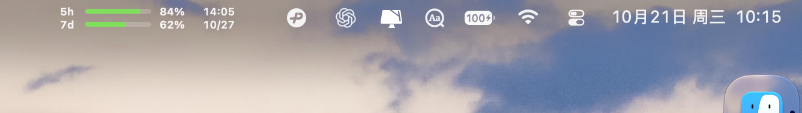

<p align="center">
  
</p>
<h1 align="center">Codot</h1>
<p align="center"><strong>Your Codex quota, always in sight.</strong><br>Windows taskbar · macOS menu bar</p>
<p align="center">
  <a href="https://github.com/sunfhs/codot/releases/latest"></a>
  
</p>
<p align="center">
  <a href="https://github.com/sunfhs/codot/releases/download/v1.1.0/codex-usage-compact-v1.1.0-windows-x64.zip">Download for Windows</a> ·
  <a href="https://github.com/sunfhs/codot/releases/download/v1.1.0/codex-usage-compact-v1.1.0-macos-arm64.zip">Mac · Apple Silicon</a> ·
  <a href="https://github.com/sunfhs/codot/releases/download/v1.1.0/codex-usage-compact-v1.1.0-macos-x64.zip">Mac · Intel</a>
</p>
<p align="center"><a href="README.md">English</a> · <a href="README.zh-CN.md">中文</a> · <a href="README.ja.md">日本語</a></p>

An independent personal project maintained by [sunfhs](https://github.com/sunfhs). The Windows and macOS implementations adapt existing upstream projects; their credits and license scope are preserved in [NOTICE.md](NOTICE.md).

Always-visible Codex quota in the **Windows taskbar** and **macOS menu bar**, maintained in one repository with one release page.

```text
5h  ━━━━━━━───  55%  20:37
7d  ━━━━━━━━━─  93%  10/27
```

Both rows show **remaining** quota and its next reset in your computer's local time: `HH:mm` for the five-hour window, `MM/dd` for the weekly window. These values are examples; the app reads your own signed-in account. Quotas reset on the service's schedule; this app displays them.

## Download and install

[Latest release — all platforms](https://github.com/sunfhs/codot/releases/latest)

| Platform | Package | Installation |
| --- | --- | --- |
| Windows 10/11 x64 | [Download for Windows](https://github.com/sunfhs/codot/releases/download/v1.1.0/codex-usage-compact-v1.1.0-windows-x64.zip) | Extract and double-click `install.cmd` |
| Apple Silicon Mac, macOS 13+ | [Download for Apple Silicon Mac](https://github.com/sunfhs/codot/releases/download/v1.1.0/codex-usage-compact-v1.1.0-macos-arm64.zip) | Extract and double-click `Install.command` |
| Intel Mac, macOS 13+ | [Download for Intel Mac](https://github.com/sunfhs/codot/releases/download/v1.1.0/codex-usage-compact-v1.1.0-macos-x64.zip) | Extract and double-click `Install.command` |

Sign in to Codex / ChatGPT on the same computer first. The installers enable startup at login. Windows installs into the current user's directory. Mac installs to `~/Applications/CodexVisual.app`, keeps existing preferences, and backs up existing apps to `~/Applications/CodexVisual-backups/`. If an old `/Applications` copy cannot be moved due to permissions, back it up and move it using Finder first.

SHA-256 checksum files accompany the downloads. Windows binaries are unsigned. Mac apps are ad-hoc signed and are not Developer ID notarized, so macOS may block their first launch. You can build locally with the commands below; installation does not disable Gatekeeper.

## Appearance and languages

- Windows: half the original width and height, transparent background, centered in the taskbar, no GPT mark or reset suffix. [Screenshots and design history](docs/design.md).
- Mac: two native menu-bar rows in 22 points, green progress bars and text that follows light/dark appearance. Limited menu-bar space may hide the item in an overflow area.
- Both default to 60-second refreshes. Missing windows show `--`. Windows marks stale values with `*`; Mac hides expired or historical menu-bar values with `--`.
- Windows: right-click → **Language**. Mac: click the quota rows → **Language**. Choose 中文, 日本語 or English; the selection is saved. Both also offer system-language selection.
- Switching between these languages preserves remaining percentages and absolute local reset times.
- Mac's **Check for Updates** opens this project's release page for manual installation, preserving this customization.

### Windows


### macOS



*Captured from the running macOS app. Quota values reflect the time of capture.*

## Build and verify

Windows: Rust stable and Visual Studio C++ Build Tools.

```powershell
cargo test --release --locked
cargo build --release --locked
.\scripts\package.ps1
```

Mac: Xcode Command Line Tools with Swift 6 or newer.

```sh
cd macos
bash scripts/build_app.sh
bash scripts/test_quota_reader.sh
bash scripts/test_menubar.sh
bash scripts/install.command
```

GitHub Actions builds and checks Windows, Apple Silicon and Intel apps, then attaches their packages to the same release.

## Source and privacy

`src/` contains the Windows Rust/Win32 app. `macos/` contains the Swift/AppKit app. Each retains its native interface and account reader. Windows reuses local Codex credentials to read the official service. Mac uses the local `codex app-server` and retains local log fallbacks. Credentials, caches and conversations are excluded from this repository. Inspect diagnostic output before sharing because it can contain local paths.

Windows derives from [upstream-ray/codex-usage-monitor](https://github.com/upstream-ray/codex-usage-monitor). Mac derives from [orangeshushu/CodexVisual](https://github.com/orangeshushu/CodexVisual), including sunfhs's menu-bar customization. The old Mac repository remains a historical backup. See [NOTICE.md](NOTICE.md) for provenance and license scope, and [the original Mac README](macos/README.upstream.md) for inherited documentation. This community project is not affiliated with OpenAI.
