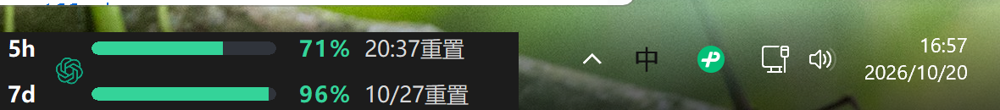
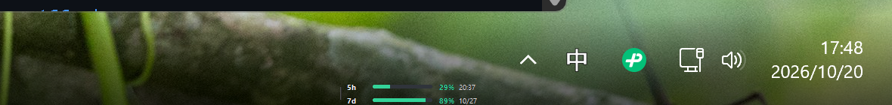

# 外观与使用感记录

## 最终效果

这个版本的重点是持续可见、少占位置、避免多余的标识与文案。两行合在一起和系统图标区域垂直居中。用户不需要打开窗口、点击托盘或切换到 Codex 才能知道额度。

## 调整过程

### 1. 原始任务栏组件

上游的任务栏形式满足持续显示需求，但图标、黑色底板和尾部文字让组件显得较重。

### 2. 去图标、去尾部文字

删除中间 GPT 图案，恢复时间从 `20:37重置`、`10/27重置` 改成 `20:37`、`10/27`。

### 3. 尝试三分之一尺寸与透明背景

透明背景更容易融入任务栏，但宽高各 1/3 后文字太小；原来的底部定位还会使组件贴住屏幕边缘。

### 4. 最终选择一半大小、居中

改为宽高各 1/2，并将顶部坐标改为 `任务栏顶部 + (任务栏高度 - 组件高度) / 2`。保留透明背景。这个版本是用户确认的最终效果。

截图按调整阶段保留，因此不同图片里的额度、时间和日期可能不同；它们不是固定演示数据。

## 源码改动索引

| 文件 | 修改内容 |
| --- | --- |
| `src/window.rs` | DPI 后半尺寸缩放、背景像素 alpha 为 0、任务栏垂直居中、缩短时间列的测量样本、中文与每分钟刷新默认值、默认细条与大字选项 |
| `src/provider_icons.rs` | 跳过 Codex provider 图案绘制，保留其他 provider 的上游逻辑 |
| `src/poller.rs` | 中文 5 小时/每周格式不再添加“重置”后缀，同步现有测试预期 |
| `Cargo.toml` / `Cargo.lock` | 独立版本 1.0.0、项目地址和产品说明 |
| `scripts/install.ps1` | 下载指向本仓库、默认配置开机启动、兼容缺少 PE 字符串版本的本地构建 |
| `scripts/package.ps1` / `scripts/install.cmd` | 可复现的发布打包和解压后双击安装入口 |
| `.github/workflows/release.yml` | Windows 测试、编译和 Release 产物打包 |

## 保留的交互

左侧细线仍可横向拖动；悬停仍可查看用量更新时间和错误；右键仍可打开菜单。透明区域不会再遮住任务栏底色。半尺寸和透明样式是本定制版的固定外观，当前没有另加任意缩放配置。
